# Office Face ID: Ubuntu/NVIDIA Runbook

Normal delivery uses **SCRFD-2.5G**, the supplied ArcFace R50 recognizer, and the
custom YOLOX-Tiny CrowdHuman head/body detector. It provides explicit single-person
and bulk enrollment, **up to five Registered Photos plus five approved Live Photos
per person**, and multiple configurable RTSP inputs. The local dashboard normally
opens at **http://127.0.0.1:9170/**.

This is a controlled evaluation, not a production access-control or attendance
system. A fresh installation has no enrolled people or configured cameras. The
office delivery directory contains neither private photos/videos nor runtime
databases or model weights. Use the sparse checkout below to avoid unrelated
legacy repository assets. Do not run the older PoC installer or `research_demo/bootstrap.sh` for
this entry point. Shared research Python modules are source dependencies only;
there is no DigiFace download, synthetic-gallery build, research-service startup,
or 10G model installation in this runbook.

The optional-review update adds **Unknown faces** and **Review notices**, disabled
by default. These are for the controlled, consented office test only. They do not
create an automated security decision or a general CCTV watchlist. See
[Optional Review Tools](#17-optional-review-tools).

The **23 October update** adds stable recent-recognition cards with observed
camera snapshots and an all-settings reset. See the
[release and upgrade checklist](RELEASE_20261023.md) before updating an existing
installation. Existing saved settings, cameras and people are retained.

## Contents

- [Scope, Rights and Safety](#scope-rights-and-safety)
- [Module and Data Flow](#module-and-data-flow)
- [1. Prepare the Ubuntu Host](#1-prepare-the-ubuntu-host)
- [2. Get the Correct Source](#2-get-the-correct-source)
- [3. Set Private Paths and Defaults](#3-set-private-paths-and-defaults)
- [4. Obtain and Prepare the Three Models](#4-obtain-and-prepare-the-three-models)
- [5. Build, Start and Verify CUDA](#5-build-start-and-verify-cuda)
- [6. Open the Dashboard](#6-open-the-dashboard)
- [7. Enroll People](#7-enroll-people)
- [8. Configure Multiple RTSP Cameras](#8-configure-multiple-rtsp-cameras)
- [9. Quality, Voting and Head-Track Continuity](#9-quality-voting-and-head-track-continuity)
- [10. Review Live References](#10-review-live-references)
- [11. Optional Recorded Fixture](#11-optional-recorded-fixture)
- [12. Fresh Ubuntu Release Check](#12-fresh-ubuntu-release-check)
- [13. Persistence, Backup and Restore](#13-persistence-backup-and-restore)
- [14. Tests and CPU Development](#14-tests-and-cpu-development)
- [15. Troubleshooting](#15-troubleshooting)
- [16. Optional Separate Research and Validation Limits](#16-optional-separate-research-and-validation-limits)
- [17. Optional Review Tools](#17-optional-review-tools)

## Scope, Rights and Safety

Read [model-use and business limitations](../docs/MODELS_AND_LIMITATIONS.md),
[model provenance](../MODEL_PROVENANCE.md), and
[shared third-party notices](../research_demo/THIRD_PARTY_NOTICES.md) before using
or redistributing the supplied weights.

- InsightFace source is MIT-licensed. Its supplied ArcFace/SCRFD pretrained
  weights have separate non-commercial research restrictions unless separately
  authorized. See the [official licensing guidance](https://github.com/deepinsight/insightface#license).
- The custom CrowdHuman head/body checkpoint needs its own provenance/reuse
  clearance. It is not a generic COCO YOLOX checkpoint.
- Staff consent, repository access and possession of the model ZIP do not grant
  model rights. A paid/client demonstration is not automatically exempt from
  restrictions. Obtain appropriate authorization before that use.
- Obtain explicit participant and camera/recording authorization. Scope a session
  to that material only; do not search for unrelated staff photos or mine videos
  for enrollment. The commands do not grant consent.
- No liveness/anti-spoofing, calibrated real-person false-accept rate, encryption
  at rest, production authentication or consequential-decision acceptance is
  claimed. Never use a match as the sole security or employment decision.
- Keep models, images, reports, credentials and backups private and outside Git.
  The loopback-only API has no user login; local users with access to the host
  remain inside the trust boundary.

## Module and Data Flow

The API/UI, per-camera capture threads, bounded tracking workers and independent
recognition worker have separate responsibilities. Qdrant is a separate service.
Detection/recognition sessions are shared; each camera retains its own tracker.

```mermaid
flowchart LR
    R["Authorized RTSP feeds"] --> F["Per-camera FFmpeg capture<br/>Software decode / optional NVDEC"]
    F --> T["Tracking workers<br/>YOLOX heads + ByteTrack"]
    F --> S["SCRFD-2.5G faces"]
    T --> A["Head / face association"]
    S --> A
    A --> G["Query quality gates"]
    G --> W["Recognition worker<br/>ArcFace embeddings"]
    W --> Q["Private Qdrant reference search"]
    Q --> V["Person-level votes<br/>Tentative / Confirmed / Unknown"]
    T --> H["Continuous head identity"]
    V --> H
    H --> API["FastAPI + browser UI"]
    E["Explicit photo/folder/ZIP enrollment"] --> P["Quality + ArcFace"]
    P --> DB["SQLite + private JPEGs<br/>5 registered + 5 approved live"]
    DB --> Q
    W --> C["Registered-only candidate checks"]
    C --> U["Operator review"]
    U --> DB
    API --> E
    API --> U
```



A stored live reference is not authority to admit another one. A name carried by
a head track is display continuity, not a new face observation or enrollment.

## 1. Prepare the Ubuntu Host

### Hardware and pinned application stack

The existing hardware evidence is from Ubuntu 22.04.5 x86_64, a Ryzen 7 2700,
about 24 GB RAM, and an NVIDIA TITAN X Pascal with 12 GB VRAM and driver
535.274.02. This is a tested configuration, not a minimum-memory specification or
a throughput guarantee for other GPUs. The GPU image is Linux AMD64, not Jetson,
ARM Linux, native Windows or Apple GPU support.

| Component | Normal delivery |
| --- | --- |
| CUDA base | `nvidia/cuda:12.2.2-cudnn8-runtime-ubuntu22.04` |
| Container Python | Ubuntu 22.04 Python 3.10 in an isolated venv |
| ONNX Runtime GPU | `1.18.0`, official CUDA 12 / cuDNN 8 CPython 3.10 wheel |
| NumPy | `1.26.4` |
| Qdrant server / client | `qdrant/qdrant:v1.15.5` / `qdrant-client==1.15.1` |
| Face detector | `scrfd_2.5g`, supplied SCRFD-2.5G ONNX |
| Optional fixture relay | `bluenviron/mediamtx:1.15.3` |
| Capture / query defaults | Software decode; quality strictness 50; minimum face width 70 px |

The [ORT compatibility matrix](https://onnxruntime.ai/docs/execution-providers/CUDA-ExecutionProvider.html)
pairs ORT 1.18.0 CUDA 12 with cuDNN 8; 1.18.1's CUDA 12 build uses cuDNN 9.
The [ORT installation guide](https://onnxruntime.ai/docs/install/) explains the
separate older CUDA 12 packages. `requirements-gpu.txt` pins the exact wheel URL
and SHA-256. PyPI's plain `onnxruntime-gpu==1.18.0` is a different CUDA build.
Do not replace the wheel, install both ORT variants, or upgrade to latest ORT.

The [CUDA 12.2.2 release notes](https://docs.nvidia.com/cuda/archive/12.2.2/cuda-toolkit-release-notes/index.html)
list Linux driver 535.104.05 for that toolkit and 525.60.13 as the CUDA 12.x
minor-compatibility minimum. Use the approved working 535-series driver for this
Pascal target; record its actual patch version. Driver installation, Secure Boot
configuration and any reboot belong to the server administrator. Do not upgrade
a shared server's driver as part of running this demo.

"RTX 5000" can refer to several GPU generations. This pinned image is not a
verified RTX PRO Blackwell runtime; newer architectures may require a separately
validated CUDA/cuDNN/ORT stack. Record the exact `nvidia-smi` GPU model and run
the kernel doctor before treating any untested device as compatible.

Allow disk space for Docker image layers/build cache, the 182,873,019-byte model
ZIP, roughly 198 MB of extracted weights, private runtime data, and a separate
backup. Media needs additional space. Check `df -h` before importing material;
neither a fixed camera capacity nor an all-day stability guarantee is provided.

### One-time administrator setup

Skip installation steps already completed on a prepared server. These commands
are for an approved fresh Ubuntu host, not permission to reconfigure another
project. Have the administrator resolve conflicting Docker packages, daemon
configuration and firewall policy first. Use the
[official Docker Ubuntu instructions](https://docs.docker.com/engine/install/ubuntu/)
and [Linux post-install instructions](https://docs.docker.com/engine/install/linux-postinstall/).

Install host utilities:

```bash
sudo apt-get update
sudo apt-get install -y ca-certificates curl gnupg git python3 unzip openssh-client
```

After configuring Docker's official apt repository using that guide, install
`docker-ce`, `docker-ce-cli`, `containerd.io`, `docker-buildx-plugin` and
`docker-compose-plugin`:

```bash
sudo apt-get update
sudo apt-get install -y docker-ce docker-ce-cli containerd.io \
  docker-buildx-plugin docker-compose-plugin
```

Use the Compose plugin (`docker compose`), not legacy
`docker-compose`. Arrange approved access to the Docker socket for the operator;
Docker-group membership is effectively privileged access. Re-login after any
membership change. Do not solve socket errors with permissive `chmod`.

Follow the [official NVIDIA Container Toolkit installation guide](https://docs.nvidia.com/datacenter/cloud-native/container-toolkit/latest/install-guide.html)
to add its signed repository. After the guide's package-list update, install
`nvidia-container-toolkit` using the approved version from that repository.
Installing the package alone does not configure Docker. The administrator then
performs:

```bash
sudo nvidia-ctk runtime configure --runtime=docker
sudo systemctl restart docker
```

That restart can affect other workloads: schedule it, and skip it on an already
configured host. This runbook assumes the standard rootful Docker daemon;
rootless setups require their separate NVIDIA configuration and site validation.
No host CUDA toolkit, cuDNN installation, TensorRT, Torch, host pip environment or
FP16 conversion is required for the Docker path.

For fixture preparation or native CPU work only, also install host `ffmpeg`
(which supplies `ffprobe`). Docker app/fixture-publisher images already contain
both. The remote Ubuntu host needs an administrator-configured SSH service if
you will use the browser through an SSH tunnel.

### Preflight before building

Run these as the intended non-root operator:

```bash
uname -m
python3 --version
nvidia-smi
docker version
docker info
docker compose version
df -h "$HOME"
docker run --rm --gpus all \
  nvidia/cuda:12.2.2-cudnn8-runtime-ubuntu22.04 nvidia-smi
```

Expect `x86_64`, reachable Docker Engine/Compose, and the intended GPU in both
host and container output. The last command may pull the base image and launches
only a temporary GPU check. A successful `nvidia-smi` is necessary but does not
prove that the application models execute CUDA kernels; the doctor below does.

Initial setup needs approved outbound HTTPS for GitHub, Docker image registries,
Ubuntu repositories, PyPI/the pinned Microsoft wheel feed, and the model download.
A proxy/offline site should arrange approved caches and trusted certificates.
Do not bypass TLS checks. Inference does not need an external recognition API.

## 2. Get the Correct Source

Repository authorization is required. On a new machine:

```bash
git clone --filter=blob:none --sparse \
  --branch codex/office-optional-review \
  https://github.com/ashutoshbk/face_recognition.git
cd face_recognition
git sparse-checkout set \
  face_id_poc/office_demo face_id_poc/research_demo face_id_poc/docs \
  .github/workflows
git branch --show-current
git rev-parse HEAD
cd face_id_poc
```

This includes the shared vision code, notices and office helper scripts without
checking out unrelated historical staff-photo folders. Do not expand the sparse
checkout to obtain private assets. The model bundle is separate.

All remaining host commands assume this **`face_id_poc` directory** unless
explicitly stated otherwise. Do not change into `research_demo` and run its
bootstrap, asset importer or services: those use different dependencies, Qdrant
versions and gallery conventions.

For an existing checkout, first stop this office stack using its original
environment and back up its runtime. Inspect `git status`, preserve local work,
then fetch/switch/fast-forward only when appropriate:

```bash
git status --short
git fetch origin
git switch codex/office-optional-review
git merge --ff-only origin/codex/office-optional-review
```

If Git refuses, stop and reconcile the changes; do not reset or discard them.
Record the source commit and rebuild the office image after a source update.
Keep the same private runtime and model paths to retain existing enrollment.
New local source changes are not present in another machine's clone until the
release owner has committed and published them.

## 3. Set Private Paths and Defaults

Run as the operator who will own the private data. For a new normal installation:

```bash
umask 077
export OFFICE_PROJECT_NAME=camex-office-demo
export OFFICE_IMAGE=camex-office-demo:office-20261029
export OFFICE_RUNTIME_DIR="$HOME/camex-office-runtime"
export OFFICE_MODELS_DIR="$HOME/camex-office-models"
export OFFICE_FIXTURE_DIR="$HOME/camex-office-fixture"
export OFFICE_UID="$(id -u)"
export OFFICE_GID="$(id -g)"
export OFFICE_GPU_ID=0
export OFFICE_APP_PORT=9170
export OFFICE_RTSP_PORT=18555
export OFFICE_FACE_MODEL=scrfd_2.5g
export OFFICE_CAMERA_LIMIT=32
export OFFICE_HWDECODE=0
export CAMEX_OFFICE_ALLOW_AUTO_ADMISSION=0
export NO_PROXY=127.0.0.1,localhost
mkdir -p "$OFFICE_RUNTIME_DIR"
chmod 700 "$OFFICE_RUNTIME_DIR"
```

Use absolute local paths outside the repository. Do **not** create an empty
`OFFICE_MODELS_DIR` before the model helper: it creates a new completed directory
atomically. `OFFICE_FIXTURE_DIR` can remain nonexistent unless you use the optional
fixture. If using an existing runtime, preserve its path and inspect its saved
settings; environment defaults do not overwrite `config/settings.json`.

Restore these exports in each new terminal before any Compose/helper operation.
You may save the block in a private shell file outside the repository, mode 600,
and explicitly `source` it. No `.env` file is required. Avoid ambiguous per-project
`.env` files and never put camera URLs in this block. Preserve any additional
site-specific proxy bypasses when setting `NO_PROXY`.

| Host variable | Purpose |
| --- | --- |
| `OFFICE_PROJECT_NAME` | Owns this stack's containers, networks and named volume |
| `OFFICE_IMAGE` | Image to build and run; the builder must use the same tag |
| `OFFICE_RUNTIME_DIR` | Read/write bind mount at `/runtime` |
| `OFFICE_MODELS_DIR` | Verified model directory, read-only bind at `/models` |
| `OFFICE_FIXTURE_DIR` | Optional fixture directory, read-only for its publisher |
| `OFFICE_UID` / `OFFICE_GID` | Host ownership used by app and fixture publisher |
| `OFFICE_GPU_ID` | NVIDIA device exposed to the app; default 0 |
| `OFFICE_APP_PORT` | Host loopback HTTP port; container always listens on 9170 |
| `OFFICE_RTSP_PORT` | Host loopback fixture port; relay always listens on 8554 |
| `OFFICE_FACE_MODEL` | Keep `scrfd_2.5g` for normal delivery |
| `OFFICE_CAMERA_LIMIT` | Resource guard, default 32; not measured camera capacity |
| `OFFICE_HWDECODE` | 0 software decoding; 1 requests NVDEC after separate validation |
| `CAMEX_OFFICE_ALLOW_AUTO_ADMISSION` | Keep 0; automatic live admission locked |

The wrapper supplies `OFFICE_UID`/`OFFICE_GID` automatically if omitted. Direct
Compose commands do not: keep the exports above. Files must be readable/writable
by that numeric UID/GID. Use mode 700 directories and mode 600 private files.
Do not use `chmod 777` or run all application commands with `sudo`.

## 4. Obtain and Prepare the Three Models

Download the separately supplied
[CAMEX_Research_Models_20261014.zip](https://drive.google.com/file/d/1IjOGiSdDmSLfYzq87wOLKDb5OwFdN83R/view)
in a browser, subject to the rights above. It is a Drive sharing page, not a
direct ZIP endpoint: do not save its HTML with `curl` and call that a model ZIP.
If access fails, ask the handoff owner for this exact companion bundle.

Expected archive size: **182,873,019 bytes**. Expected archive SHA-256:

```text
b20a00498d13d9bf9ea65f25122d9b9e3f02084667965f1c84d68afa8426bd86
```

Place or securely transfer it outside the checkout, for example under
`$HOME/Downloads`. Do not commit it. From `face_id_poc`:

```bash
export OFFICE_MODEL_BUNDLE="$HOME/Downloads/CAMEX_Research_Models_20261014.zip"
test -f "$OFFICE_MODEL_BUNDLE"
printf '%s  %s\n' \
  'b20a00498d13d9bf9ea65f25122d9b9e3f02084667965f1c84d68afa8426bd86' \
  "$OFFICE_MODEL_BUNDLE" | sha256sum --check -
python3 office_demo/scripts/prepare_models.py \
  --bundle "$OFFICE_MODEL_BUNDLE" \
  --output "$OFFICE_MODELS_DIR" \
  --acknowledge-model-restrictions
```

The helper uses **Python standard library only**, copies only the three base
model basenames, checks each model SHA-256, and creates private output files.
Without optional research flags it does not download anything or install 10G.
The acknowledgment means you reviewed the restrictions, not that rights were
granted. Retain the original ZIP, including its `MODEL_USAGE_NOTICE.md` and
`MODEL_MANIFEST.json`.

The completed normal model directory has these three ONNX files at its top level,
plus a generated usage notice:

| Filename | SHA-256 |
| --- | --- |
| `arcface-r50-w600k-112x112.onnx` | `4c06341c33c2ca1f86781dab0e829f88ad5b64be9fba56e56bc9ebdefc619e43` |
| `scrfd-kps-2.5g-640x640.onnx` | `a2a876b5ad23e66a8b3973112ff137f98414c214b17c31a45955d26e54b58cbf` |
| `yolox-tiny-crowdhuman-416x416.onnx` | `7880da82285f9cedd92c46c3c8edece6e751ce8558f4be080ea6325d2a19d56e` |

These values are also in `office_demo/models_manifest.json` and
`research_demo/vision/networks.py`. The helper accepts an existing model folder
or the ZIP's extracted parent containing `models/` as `--bundle`. Use the helper's
**output** as `OFFICE_MODELS_DIR`; the supplied ZIP itself nests files under
`models/`.

An already complete, matching output can be reused. An existing incomplete or
different output is refused, not overwritten: select a new destination and inspect
the old one. Never delete working model files to work around this check. Neither
Docker build nor application startup downloads weights. No commercial license
clearance follows from a hash match.

## 5. Build, Start and Verify CUDA

Build using the allowlisted staging helper, then start only this Compose project:

```bash
python3 office_demo/scripts/build_image.py --tag "$OFFICE_IMAGE"
bash office_demo/scripts/office_stack.sh config
bash office_demo/scripts/office_stack.sh up
bash office_demo/scripts/office_stack.sh status
bash office_demo/scripts/office_stack.sh logs
bash office_demo/scripts/office_stack.sh doctor
curl --fail --silent --show-error --noproxy '*' \
  "http://127.0.0.1:$OFFICE_APP_PORT/api/health"
```

`up` checks selected model filenames, waits for Qdrant readiness, starts the app,
and waits for `ready: true`. Inspect any startup error before proceeding; running
containers or an HTTP 200 alone are not application acceptance.

`doctor` runs `scripts/check_runtime.py --exercise-models` inside the app container.
It checks imports, FFmpeg/ffprobe, hashes and the requested provider, then runs
blank tensors through all three models and inspects profiled executed nodes.
Require `CUDAExecutionProvider` in each model's `executed_providers`. Merely listing
CUDA among available providers is not proof of execution. This does not identify
or enroll anybody. Normal app profiling stays disabled.

The staging helper includes office Python/static/scripts/manifests and shared
`research_demo/vision` plus `research_demo/core.py`. It does not stage models,
private fixtures or the surrounding delivery archive. Do not use a broad direct
`docker build` from a directory containing private assets.

After startup, **Diagnostics > Engine & device providers** should report the
ready engine and `scrfd_2.5g`. A fresh runtime may be healthy with zero references
and zero cameras. Add those explicitly; there is no automatic import.

### Stop and restart

```bash
bash office_demo/scripts/office_stack.sh down
bash office_demo/scripts/office_stack.sh up
bash office_demo/scripts/office_stack.sh doctor
```

`down` affects only this named project and retains its named Qdrant volume and
host runtime. Never add `--volumes` or run a global prune to fix a demo.
Services have `restart: "no"`: they do not promise automatic restart after reboot.
Saved camera records survive but are loaded **stopped**; review them and press
**Start all** or individual Start after restart.

Environment/image changes take effect when Compose recreates the app with `up`;
plain `docker restart` does not apply new environment variables. Restoring exports
does not reset persisted UI settings.

## 6. Open the Dashboard

On the Ubuntu machine, open `http://127.0.0.1:9170/`, or the configured
`OFFICE_APP_PORT`. From another computer, keep an SSH tunnel running in a terminal
**on that operator computer**, replacing the SSH destination with your authorized
account and host:

```bash
ssh -N -L 9170:127.0.0.1:9170 USER@UBUNTU_HOST
```

Then open **http://127.0.0.1:9170/** on that computer. If the local port is busy,
choose another local port, for example `19170:127.0.0.1:9170`, and browse local
port 19170. If the server app port differs, change the tunnel's destination port
too. Do not stop an unrelated service to free a port.

| Endpoint | Exposure / use |
| --- | --- |
| Office HTTP | IPv4 loopback `OFFICE_APP_PORT`, default 9170 |
| Qdrant REST / gRPC | Internal Docker database network, `qdrant:6333` / `qdrant:6334`; not host-published |
| Optional fixture RTSP | IPv4 loopback `OFFICE_RTSP_PORT`, default 18555; app uses `mediamtx:8554` |
| Physical cameras | App makes outbound RTSP/TCP connections to authorized camera addresses |

Do not open inbound Qdrant or camera RTSP ports on this host just to make the UI
work. Docker-published ports need their own firewall review; do not assume UFW
alone controls them. The API trusts localhost hostnames and rejects cross-origin
requests. Do not publish it directly to the LAN/internet or bypass these checks.

**Capture photos** uses the webcam attached to the **browser's computer**, with
explicit browser permission. Localhost over the tunnel supports that workflow;
it does not turn the remote Ubuntu host's camera into the browser camera.

## 7. Enroll People

### Names, images and the two reference pools

Only enroll authorized, consenting people. Use clear, single-person photos with
a native visible face, not a resized small face or a screenshot of another
registration. Exactly one visible detected face must pass quality checks.

| Limit | Behavior |
| --- | --- |
| File type | JPEG/JPG or PNG |
| Per image | At most 12 MB; at most 24 megapixels; both image dimensions at least 80 px |
| Per import | 1-200 files, at most 128 MB total |
| ZIP | At most 200 file entries / 128 MB expanded; unsafe paths, symlinks and excessive compression rejected |
| Person name | 1-80 printable characters, normalized; no path separators or unsafe folder names |
| Reference face width | At least 70 native pixels, even if query eligibility is relaxed |
| Registered / Live pools | At most five references each, separately |

Input-image dimensions and **detected face width** are different checks. Accepted
preview items can still be declined at commit as duplicates or because five
better/equal references already exist. Exact existing normalized names update
that person. Check names carefully: image-quality scoring cannot correct a
human's wrong identity label.

Eligible images fill empty slots. When full, a better image can replace the
lowest-quality reference; near-identical images are rejected. Changing trusted
Registered Photos invalidates dependent Live Photos until rechecked. Stable
person IDs are separate from display names.

### UI: one person or webcam

1. Open **People > Enroll images** and choose **Person**.
2. Select **New person** and enter the name, or select the existing person.
3. Select that person's JPG/PNG images. Alternatively choose **Capture photos**,
   **Start camera**, explicitly permit access, take up to five photos, then
   **Use photos**. Capture alone does not register them.
4. Confirm the authorization/participant-consent checkbox.
5. Choose **Upload for preview**. Review the person, each image, quality and
   rejection reason. Use **Revise selection** if anything is wrong.
6. Choose **Commit enrollment**, then check the person's **Registered Photos**.

Do not select several people's images in Person mode: they would share the
selected identity label. The webcam is for explicit enrollment, not continuous
background capture.

### UI: one-person folder, bulk folders or ZIP

Use this layout, with one immediate image-containing directory per person:

```text
consented-reference-import/
  Person_A/
    front.jpg
    slight_left.jpg
  Person_B/
    front.jpg
    alternate_lighting.jpg
```

Choose **Folders**, then select either the parent above for bulk import or a
directory named for one participant for a single-person import. Folder paths are
used to infer names. Do not add a nested `photos/` level under every person:
the immediate parent of an image becomes its inferred person name. For **ZIP**,
choose an archive of the same layout, not a ZIP of miscellaneous unlabelled photos.

Review every inferred name and accepted/rejected row before committing. Split
larger authorized collections into separate reviewed batches. Folder import adds
**Registered Photos**, never pre-approves the Live Photos pool.

### CLI: bulk or single-person folder, with a review boundary

The helper needs host Python only; it calls the already running loopback API.
Choose a **new report path** before each invocation. Reports contain names and
preview tokens and must remain private. For bulk enrollment:

```bash
umask 077
export ENROLL_ROOT="$HOME/consented-reference-import"
export ENROLL_REPORT="$OFFICE_RUNTIME_DIR/reports/enrollment-preview-$(date -u +%Y%m%dT%H%M%SZ).json"
test ! -e "$ENROLL_REPORT"
python3 office_demo/scripts/enroll_folder.py "$ENROLL_ROOT" \
  --api "http://127.0.0.1:$OFFICE_APP_PORT" \
  --consent --report "$ENROLL_REPORT"
python3 -m json.tool "$ENROLL_REPORT"
```

Inspect `preview.groups`: names, existing person IDs, accepted items and reasons.
For **single-person CLI import**, set `ENROLL_ROOT` to a parent containing only
`Person_A/` and that person's images, then use the same commands. Do not point
this helper directly at the leaf folder: its relative paths must include the
person directory.

For a legacy flat folder containing exactly one participant per filename,
use `--flat-names` on the preview command. Each filename stem becomes a person
name; this is not a multi-photo grouping convention.

Only **after reviewing and approving that preview**, commit its exact token:

```bash
python3 - "$ENROLL_REPORT" "http://127.0.0.1:$OFFICE_APP_PORT" <<'PY'
import json
import sys
import urllib.request
from pathlib import Path
preview = json.loads(Path(sys.argv[1]).read_text())["preview"]
body = json.dumps({"token": preview["token"]}).encode()
request = urllib.request.Request(
    sys.argv[2] + "/api/enroll/commit", data=body,
    headers={"Content-Type": "application/json"})
opener = urllib.request.build_opener(urllib.request.ProxyHandler({}))
with opener.open(request, timeout=180) as response:
    result = json.load(response)
print(json.dumps(result, indent=2))
PY
```

Previews expire after ten minutes and are memory-only; restart or expiration
requires a new preview. Inspect `accepted`/`rejected` and per-file commit details,
then verify the UI. A partial failure is not permission to blindly repeat a
write. The helper's `--commit` option combines preparation and commit without
pausing for a human review; it is not the recommended interactive workflow, and
rerunning it does not commit the previous token.

## 8. Configure Multiple RTSP Cameras

Obtain each authorized camera's actual RTSP address, credentials, channel and
stream path from its administrator. No real camera URL is shipped here.
Prefer a supported H.264 stream over RTSP/TCP for initial validation. Use percent
encoding for reserved characters in username/password components.

1. Open **Cameras > Add camera**.
2. Enter a unique descriptive name, at most 80 characters, and the private RTSP
   URL in the password field.
3. Confirm camera/participant authorization and choose **Add camera**.
4. Start that camera, wait for fresh frames and inspect quality, frame age,
   analysis FPS and detections. Add the remaining cameras one at a time.
5. Use individual Start/Stop or **Start all / Stop all**. Remove a wrong record
   and add the corrected one; there is no general camera-edit endpoint.

The connection originates inside the **app container**, not the browser. Its
streams network must reach the camera subnet/DNS and the camera's configured TCP
RTSP port, commonly 554. Check VLAN routes, VPN access, firewall rules, credentials
and Docker subnet overlap with the administrator. RTSP interleaved TCP does not
require publishing RTP/UDP ports from this Compose stack. `127.0.0.1` inside the
container is not a physical camera or the host. An intentionally host-run relay
may use the configured `host.docker.internal` gateway, but a host service bound
only to loopback may still be inaccessible through that gateway.

RTSPS URLs pass input validation, but server certificates, codecs and transport
compatibility require site-specific checks. Start with software decode
(`OFFICE_HWDECODE=0`). After separate NVDEC validation you can set it to 1 and run
`office_stack.sh up` to recreate the app. The diagnostic label says NVDEC was
requested; confirm actual fresh frames and resource behavior, not just the label.
There is no promise of automatic software fallback after a hardware-decode error.

Camera URLs are saved in plaintext in the private runtime's
`config/cameras.json`, mode 600; the UI reports a redacted address. Do not paste
credentials into shared terminals, screenshots, Git, issue reports or shell
history. Decoder subprocess arguments may be visible to privileged/local users.
Keep the host access-controlled. Do not overwrite runtime camera configuration
with a fixture manifest.

The default 32-camera guard is a resource bound, not a tested capacity. GPU mode
has two bounded tracking workers and a separate recognition worker; each camera's
tracker remains serial. Add load gradually and measure actual latency/coverage.
Camera-local head IDs are not cross-camera re-identification IDs.

## 9. Quality, Voting and Head-Track Continuity

### Normal settings and explicit test settings

Open **Diagnostics > Evaluation settings**. A fresh installation starts with the
**Office Demo evaluation preset** (`office-demo-20261023`):

| Control | Default | Meaning |
| --- | --- | --- |
| Recognition quality strictness | 49 | Query eligibility, separate from enrollment quality |
| Minimum face width | 20 px | Native detected face width for diagnostic recognition queries |
| Match threshold / margin | 0.30 / 0.06 | Cosine and other-person separation gates |
| Admission threshold / margin | 0.68 / 0.10 | Stricter registered-only reference gates |
| Analysis FPS / Recognition Hz | 10 / 1 | Scheduling targets, not promised throughput |
| Adaptation mode | Review | Human review of qualifying live candidates |
| Single-reference mode | Review | Strict one-photo bootstrap proposals require explicit human approval |
| Face detection | Full frame | SCRFD-2.5G; optional bounded head-detail diagnostic |

The quality slider ranges from 0 relaxed to 100 strict and has a numeric input.
It changes query eligibility, not the identity similarity threshold or the
quality score. The face-width control can go down to **20 px for diagnostic
query testing only**. Choose **Save settings** after changes. **Reset all settings**
fetches the complete preset from `GET /api/settings/defaults`, asks for confirmation,
and restores all 19 controls, including disabled optional-review features, in one validated settings update. The result is
saved to `config/settings.json`; no additional Save click is needed. Cameras,
people and registered/live photos are not deleted. Upgrades do not overwrite
existing saved settings; use Reset explicitly to adopt this preset.

This preset reproduces the office test, not a calibrated production threshold.
Small, blurred or oblique faces and a lower matching threshold may increase
false matches. The earlier 0.10 threshold / quality 10 experiment is **not** the
delivery preset. For a separate stricter comparison, explicitly set threshold
0.45, margin 0.06, width 70 and quality 50, then Save settings. Keep test results
and settings recorded separately. Registered-photo quality remains strict.

Relaxing queries can increase false matches. Clipped faces, low detector
confidence and ambiguous head associations remain blocked. Registered and live
reference admission still uses the original quality checks and a minimum width
of at least 70 px; one-photo bootstrap additionally needs 80 px and its other
gates. Enlarging a small crop does not create native image detail.

Face overlays use cyan for quality-eligible, head-associated faces and amber for
rejected/unassigned detections, including native width and five landmarks.
Eligibility is not identification. The optional `head_detail` setting adds at
most one rotating native-pixel head-region SCRFD pass per frame, retains
full-frame detections and merges duplicates. It is not a detector change or an
established accuracy improvement.

### Progressive person-level voting

A usable face is aligned and encoded by ArcFace. Qdrant searches active registered
and live references; results are grouped by person. Five references belonging to
one person do not produce five votes from a single frame.

The system keeps at most **five recent observations**, with a **cadence-aware
time window** of `max(8, 5 / recognition_hz)` seconds. It is eight seconds at
recognition rates of at least 0.625 Hz, and up to 25 seconds at the supported
minimum 0.2 Hz. It is not an unconditional eight-second expiry. Votes must come
from distinct frames and are spaced by at least 0.4 seconds.

The first qualifying leading identity is **Tentative**. **Confirmed** requires
at least three supporting observations, a unique leading identity, latest
observation support, and at least one second between its first and last support.
Later usable evidence may revise or clear the identity. Poor coverage, slow
scheduling or too few eligible faces can leave a person Unknown; timing targets
do not guarantee confirmation.

### Head-tracked names and held evidence

A confirmed identity can stay attached to a continuous, unambiguous observed
head when the face turns away or fails query quality. The UI displays
**Head-tracked** with the age of the last face match, not a fresh face confirmation.
It does not grant new votes or permission to save live references.

The panel below each camera shows **Recent recognitions**, not all active heads.
It retains up to 20 named track entries during the current browser session,
newest first. Repeated matches update the same entry, including the latest
similarity score and first/last-seen times in the browser's local timezone.
These times describe observations by the open dashboard, not an audit log.
Tentative results stay labelled Tentative; missing current evidence is marked
Not revalidated, and departed tracks are marked Earlier match. A revised name
updates the existing row and identifies the previous name. History is cleared
on page reload, recognition-setting changes or a detected backend restart.
Deleted people are removed from the history. The frontend does not create new
recognition evidence or promote a tentative match to Confirmed.

Each recognition can include a clickable **Camera crop** from the observed face,
not the person's enrolled portrait. Only a sample belonging to that proposed
identity is used. A better-quality crop may replace it. The snapshot remains
in browser memory with its history entry after the short-lived sample endpoint
expires; it is not stored in local storage or added to the enrollment gallery.
Snapshot requests are deduplicated, limited to 2 MB each, and discarded when
the identity changes or its entry leaves the bounded history. If no observed
crop is available, the row says No snapshot rather than substituting an
enrolled portrait. Image availability does not confirm the proposed identity.

Unknown heads, rejected faces, voting details, last-face-match age and crop
previews remain in the expandable **Track evidence** section. Changing the
presentation does not change tracking, matching or live-photo admission rules.

Missing detections can coast internally for at most 0.8 seconds, without drawing
a held box/label. ByteTrack may reconnect the same local ID within its two-second
lifetime. Missing heads are not drawn. Ambiguity, expiry, reconnect, relevant
configuration/gallery changes or contradictory usable face evidence clears old
associations; an overlap must not transfer a name to another person.

The evidence strip holds the five highest-quality distinct crops for the current
head identity, with earlier crops winning ties. It is separate from the recent
five voting observations. Retaining a crop does not vote again or enroll it.
Changing identity/ambiguous association clears that strip; temporary images are
bounded in memory. Neither track continuity nor the evidence strip proves
liveness or real-world identity accuracy.

## 10. Review Live References

Registered Photos are trusted explicit imports. Live Photos are camera
candidates admitted under a separate, stricter policy. Existing live photos
cannot authorize subsequent live additions.

Normal registered-only admission requires strong agreement from **2/2, 3/3, 3/4
or 4/5** registered references, the competitor margin, and repeated qualifying
observations. One registered portrait supports matching, but cannot pass this
multi-reference gate. Do not duplicate an image to manufacture independent
registered anchors.

With **Adaptation mode: Review**, open **Diagnostics > Adaptation review**,
inspect the registered reference and candidate side by side, verify the person's
identity, then explicitly approve or reject. Read the resulting status:
**Candidate not saved** is a rejection/declined write, not successful enrollment.
Check the person's Live Photos pool after approval. Ordinary proposals expire
after two minutes; stale configuration/gallery/camera evidence is rejected.

### Optional one-photo reviewed bootstrap

This is distinct from the multi-reference gate and **Off by default**. For an
explicitly authorized local test, set **Adaptation mode: Review** and
**Single-reference mode: One-photo reviewed bootstrap**, then Save settings.

A proposal requires five distinct consistent registered-anchor matches spanning
at least four seconds, cosine at least 0.60, other-person margin at least 0.15,
quality at least 65/100 and native width at least 80 px. These are engineering
screening thresholds, not false-accept guarantees. The operator must inspect
both photos and explicitly verify identity before **Confirm approval**. These
proposals expire after ten minutes.

This path never runs automatically, even if multi-reference Auto is enabled,
and every further proposal must still match the original registered anchor.
It does not turn a live image into a trusted registered photo.

Leave `CAMEX_OFFICE_ALLOW_AUTO_ADMISSION=0`. Auto is deployment-locked pending
separate approval and threshold validation; do not enable it to make this demo
appear productive. Both person-anchor and gallery-wide revisions are rechecked
at write time. Failed file cleanup remains visible as a retry count in
Diagnostics; investigate permissions rather than deleting databases.

## 11. Optional Recorded Fixture

**Skip this whole section for real cameras or the separate three-stream release
check.** The supplied fixture workflow deliberately publishes **five connections
from three unique recordings**, adding two clearly labelled repeats. It is not a
requirement to have five cameras, and no private recording is in Git.

After authorization, transfer the three source files outside the checkout:

```text
$HOME/consented-office-recordings/
  camera_a.mp4
  camera_b.mp4
  camera_c.mp4
```

Install host FFmpeg if needed. `OFFICE_FIXTURE_DIR` must be a new path; preparation
refuses overwrite. Always supply `--source-dir` on Ubuntu instead of relying on
a developer-machine default:

```bash
export OFFICE_SOURCE_DIR="$HOME/consented-office-recordings"
python3 office_demo/scripts/prepare_office_fixture.py \
  --source-dir "$OFFICE_SOURCE_DIR" --check-only
python3 office_demo/scripts/prepare_office_fixture.py \
  --source-dir "$OFFICE_SOURCE_DIR" \
  --transport-profile closed-gop --output "$OFFICE_FIXTURE_DIR"
bash office_demo/scripts/office_stack.sh fixture-up
bash office_demo/scripts/office_stack.sh logs
python3 office_demo/scripts/import_fixture.py \
  "$OFFICE_FIXTURE_DIR/cameras.docker.json" \
  --api "http://127.0.0.1:$OFFICE_APP_PORT" --authorized
```

The importer checks readiness and adds only camera records, stopped for review.
Append `--start` only when authorized to start those five newly imported records.
It refuses duplicate fixture names: inspect partial imports before retrying.

| Fixture path | Actual source |
| --- | --- |
| `camera_a` | Unique recording A |
| `camera_b` | Unique recording B |
| `camera_c` | Unique recording C |
| `camera_d_replay_a` | Explicit REPLAY of A, not another viewpoint |
| `camera_e_replay_b` | Explicit REPLAY of B, not another viewpoint |

Use `cameras.docker.json` for the container app; `cameras.host.json` is for a
native host app and assumes the default host RTSP port 18555. If changing that
host port, adjust a private copy before native use. Neither file is the app's
runtime `config/cameras.json`.

Preparation records hashes and timestamps. Default `copy` transport preserves
source compressed video/phase and only supports a common keyframe-aligned start;
the documented supplied long-GOP clips do not support an arbitrary one-second
stream-copy start. The explicit `closed-gop` command above instead re-encodes a
separate H.264, 20 FPS copy with one-second GOPs, no B-frames and normalized
timestamps for repeated transport. Keep originals for quality evaluation.
Clip-relative alignment and approximately simultaneous publisher starts do not
validate hardware/NTP synchronization.

The Compose publisher already has FFmpeg. If instead publishing from the host,
start only the relay and run `publish_fixture.sh` with the configured loopback
RTSP base; do not run host and container publishers together. Stop fixture
services alone with `bash office_demo/scripts/office_stack.sh fixture-down`.
This stops publishing, not app camera records; use Stop in the UI too.

## 12. Fresh Ubuntu Release Check

This is the reproduction recipe; see the dated
[delivery validation](VALIDATION_20261020.md) for checks actually completed.
On the fresh Ubuntu host, complete Sections 1-4, then use a separate
project, image, runtime and app port. Do not repoint an existing production or
research runtime:

```bash
export OFFICE_PROJECT_NAME=camex-office-release-check
export OFFICE_IMAGE=camex-office-demo:release-check
export OFFICE_RUNTIME_DIR="$HOME/camex-office-release-check-runtime"
export OFFICE_FIXTURE_DIR="$HOME/camex-office-release-check-fixture"
export OFFICE_APP_PORT=9182
export OFFICE_FACE_MODEL=scrfd_2.5g
export OFFICE_HWDECODE=0
export CAMEX_OFFICE_ALLOW_AUTO_ADMISSION=0
umask 077
mkdir -p "$OFFICE_RUNTIME_DIR"
chmod 700 "$OFFICE_RUNTIME_DIR"
python3 office_demo/scripts/build_image.py --tag "$OFFICE_IMAGE"
bash office_demo/scripts/office_stack.sh up
bash office_demo/scripts/office_stack.sh doctor
```

Use the already verified base-three `OFFICE_MODELS_DIR` and UID/GID exports.
If the example runtime already exists, choose a new path/project for a genuinely
fresh check rather than claiming a reused configuration is clean.

Forward the release port from the operator computer:

```bash
ssh -N -L 9182:127.0.0.1:9182 USER@UBUNTU_HOST
```

Open **http://127.0.0.1:9182/**. Explicitly enroll the authorized references and
add the **same three operator-supplied synchronized 09:16-09:21 streams**, with
their URLs entered privately. Use exactly those three inputs, not the optional
five-connection fixture. Their stated alignment is input context; this release
check does not independently certify NTP/camera-clock synchronization.

First verify **SCRFD-2.5G** and the Office Demo preset from section 9. Collect a
baseline with those settings. For a stricter comparison, explicitly set threshold
0.45, margin 0.06, width 70 and quality 50, Save settings and record a separate
result. **Reset all settings** returns to the complete Office Demo preset,
including its 20-pixel query minimum; it does not mean a stricter 70-pixel profile.

Acceptance checks: model CUDA execution; expected three records; fresh decoded
frames and current overlays; correct single/bulk preview and commit; isolated
camera stop/reconnect; persisted references/settings after this stack's restart;
no automatic live writes; and explicit review/rejection behavior. Confirm that
head-tracked names are distinguished from current face evidence.

A local timing capture is available after all configured cameras are started:

```bash
python3 office_demo/scripts/measure_smoke.py \
  --api "http://127.0.0.1:$OFFICE_APP_PORT" --wait-ready --seconds 60 \
  --output "$OFFICE_RUNTIME_DIR/reports/release-50-70-$(date -u +%Y%m%dT%H%M%SZ).json"
```

Use a new filename and distinct label for each setting pair. Retain source
commit, image ID, driver/GPU, model hashes, settings, input identities and actual
observations privately. These measurements describe that run, not recognition
accuracy or a general camera-capacity rating.

## 13. Persistence, Backup and Restore

| Location | Contents / lifetime |
| --- | --- |
| `OFFICE_RUNTIME_DIR/database/office.sqlite3` | Authoritative people, vectors, references, audit and cleanup records; WAL sidecars may exist |
| `OFFICE_RUNTIME_DIR/Face_ID/people/` | Registered/live JPEGs and per-person metadata |
| `OFFICE_RUNTIME_DIR/config/cameras.json` | Saved camera records, including private URLs |
| `OFFICE_RUNTIME_DIR/config/settings.json` | Persisted UI settings |
| `OFFICE_RUNTIME_DIR/reports/` | Private local diagnostic outputs |
| Project `qdrant-data` named volume | Derived searchable reference index |
| `OFFICE_MODELS_DIR` | Separate immutable, hash-verified models |
| Memory only | Pending enrollment previews, track/evidence strips and uncommitted live candidates |

Do not copy only JPEGs, or only SQLite, and expect a complete restoration.
SQLite and JPEG paths belong together; stored photo paths are absolute in the
app's `/runtime` namespace. Keep that container mount path unchanged when moving
host directories. Native-to-container or different-native-path migrations need
a reviewed path migration, not a blind copy.

### Cold backup

Stop this project's app and database before taking both copies; copying live
SQLite/WAL and Qdrant files independently is not a consistent snapshot. The
example streams a cold Qdrant archive using the already built image, with no GPU,
network or model access. Choose a new backup directory:

```bash
(
  set -euo pipefail
  umask 077
  BACKUP_DIR="$HOME/camex-office-backups/$(date -u +%Y%m%dT%H%M%SZ)"
  test ! -e "$BACKUP_DIR"
  mkdir -p "$BACKUP_DIR"
  QDRANT_VOLUME="$OFFICE_PROJECT_NAME"_qdrant-data
  docker volume inspect "$QDRANT_VOLUME" >/dev/null
  bash office_demo/scripts/office_stack.sh down
  tar -C "$OFFICE_RUNTIME_DIR" -czf "$BACKUP_DIR/runtime.tar.gz" .
  docker run --rm --network none --user 0:0 --entrypoint tar \
    --mount "type=volume,src=$QDRANT_VOLUME,dst=/backup-source,readonly" \
    "$OFFICE_IMAGE" -C /backup-source -czf - . > "$BACKUP_DIR/qdrant.tar.gz"
  git rev-parse HEAD > "$BACKUP_DIR/source-commit.txt"
  docker image inspect "$OFFICE_IMAGE" --format '{{.Id}}' \
    > "$BACKUP_DIR/image-id.txt"
  (
    cd "$BACKUP_DIR"
    sha256sum runtime.tar.gz qdrant.tar.gz > SHA256SUMS
  )
  printf 'Private backup: %s\n' "$BACKUP_DIR"
)
```

Keep the exports/deployment record, approved model bundle and its hash with your
controlled backup inventory. Encrypt backups using the site's approved process
before transfer and define retention/deletion rules; this example does not
implement encryption. Backups may contain credentials, face images and biometric
templates. Do not upload them as routine issue attachments.

After backup, use the same exports with `up` and `doctor`, then explicitly start
reviewed camera records. No automatic restart is performed by the backup block.

### Restore into an isolated destination

1. Verify `SHA256SUMS` in the backup directory before extracting.
2. Select the recorded release/dependencies, verify its models, set a **new**
   project/runtime and an unused host app port. Keep models at `/models` and the
   runtime at `/runtime` inside the container.
3. With the target app/database stopped, restore the complete runtime archive
   into the empty target host directory. Preserve directory/file modes; arrange
   ownership for the target `OFFICE_UID`/`OFFICE_GID`. Do not overlay an active
   or partially populated runtime.
4. Restore `qdrant.tar.gz` into the new project's empty `qdrant-data` volume with
   Qdrant stopped. Use Qdrant 1.15.5 and the paired snapshot; do not attach older
   or unrelated research storage.
5. Start, run doctor and inspect `ready`, people/reference counts, reference
   images, saved settings and stopped camera records. Recheck the site-specific
   URLs privately before starting feeds. Keep the original backup untouched.

Qdrant is derived: the app synchronizes active references from authoritative
SQLite at startup, so a controlled restore can rebuild an empty dedicated index.
This is not permission to delete a shared Qdrant volume or omit SQLite/images.
Exercise restoration separately before relying on a backup.

## 14. Tests and CPU Development

The dedicated workflow
[Office Face ID source tests](../../.github/workflows/office-demo-tests.yml)
runs the office suite on Ubuntu 22.04/Python 3.10 with pinned CPU dependencies,
plus a Node.js syntax check. CI intentionally has no model bundle, private media
or real-camera credentials. Do not infer GPU/model/camera validation from CPU CI
or a skipped asset-dependent test. Consult the actual run status for the release.

For local source tests, use a separate CPU environment, not the deployed GPU
venv. On Ubuntu 22.04, install the native prerequisites first:

```bash
sudo apt-get install -y build-essential python3.10-dev python3.10-venv ffmpeg
python3.10 -m venv "$HOME/.venvs/camex-office-cpu"
source "$HOME/.venvs/camex-office-cpu/bin/activate"
python -m pip install --index-url https://pypi.org/simple \
  pip==24.3.1 setuptools==75.6.0 wheel==0.45.1 Cython==3.0.11 numpy==1.26.4
python -m pip install --index-url https://pypi.org/simple --no-build-isolation \
  -r office_demo/requirements-cpu.txt pytest==8.3.5
python -m pip check
PYTHONDONTWRITEBYTECODE=1 python -m pytest -q -p no:cacheprovider office_demo/tests
```

The explicit test path matters: the parent package's default discovery targets a
different `tests/` directory. To run the supplied-model CPU test separately:

```bash
CAMEX_TEST_MODELS="$OFFICE_MODELS_DIR" CAMEX_TEST_PROVIDER=CPUExecutionProvider \
  PYTHONDONTWRITEBYTECODE=1 python -m pytest -q -p no:cacheprovider \
  office_demo/tests/test_models.py
```

A Node.js 22 installation, as used by CI, can also run
`node --check office_demo/static/app.js`. Do not install Node or pytest into the
normal runtime image merely to start the app. For actual GPU validation, use
the normal stack's `doctor` rather than replacing CPU wheels in this venv.

For optional native CPU development, use a **different runtime** from any
running Docker app and a dedicated Qdrant 1.15.5 server. Example:

```bash
export CAMEX_OFFICE_HOME="$HOME/camex-office-native-cpu"
export CAMEX_OFFICE_MODELS="$OFFICE_MODELS_DIR"
export CAMEX_OFFICE_PROVIDER=CPUExecutionProvider
export CAMEX_OFFICE_FACE_MODEL=scrfd_2.5g
export CAMEX_OFFICE_QDRANT_URL=http://127.0.0.1:16343
export CAMEX_OFFICE_QDRANT_GRPC_PORT=16344
export CAMEX_OFFICE_ALLOW_AUTO_ADMISSION=0
export PYTHONPATH="$PWD:$PWD/research_demo:$PWD/office_demo"
umask 077
docker run -d --name camex-office-native-qdrant \
  -p 127.0.0.1:16343:6333 -p 127.0.0.1:16344:6334 \
  -e QDRANT__TELEMETRY_DISABLED=true \
  -v camex-office-native-qdrant:/qdrant/storage qdrant/qdrant:v1.15.5
python office_demo/scripts/check_runtime.py --exercise-models
(
  cd office_demo
  python -m uvicorn app:app --host 127.0.0.1 --port 9170 --workers 1
)
```

First check that the container name and ports are unused; if your dedicated
native database already exists, inspect/start it rather than recreating it.
Stop only that database with `docker stop camex-office-native-qdrant` after
stopping the native app. Never run multiple app workers/writers on one runtime.
Do not launch the native app while Docker or another service owns port 9170.
macOS development is CPU-only; physical webcam behavior still needs local checks.

## 15. Troubleshooting

| Symptom | Check and action |
| --- | --- |
| Docker permission denied | Confirm Docker socket access for this operator and re-login after approved group changes. Do not use `chmod 777` or silently switch to root-owned private data. |
| GPU request cannot select driver / NVML error | Check host `nvidia-smi`, then the temporary GPU-container preflight. Ask the administrator to verify toolkit/runtime configuration and the driver; no blanket driver upgrade. |
| ORT CUDA provider/library error | Keep the pinned CUDA 12/cuDNN 8 image and wheel. Run doctor; provider registration alone is insufficient. Do not mix CPU/GPU wheels or replace with latest ORT. |
| Model helper refuses destination | It will not overwrite missing/different existing contents. Check bundle hash, source layout and permissions; select a new destination. |
| Missing model / checksum mismatch | Verify the three base filenames directly under `OFFICE_MODELS_DIR`, not under a second nested `models/`, and that the container UID can read them. Keep `OFFICE_FACE_MODEL=scrfd_2.5g`. |
| App fails after model error | Correct the model files/mount/env, then explicitly recreate the app with `docker compose -p "$OFFICE_PROJECT_NAME" -f office_demo/docker-compose.yml up -d --force-recreate app` and run doctor. A plain `up` may reuse the failed container; do not assume the loader retries forever. |
| Port already allocated | Inspect the owning service. Choose an unused `OFFICE_APP_PORT` and update the browser/tunnel/API URL. Keep the correct project exports; do not kill unrelated services. |
| HTTP 400/403 from another hostname | Use localhost through the SSH tunnel and one consistent origin. Do not disable host/origin checks or expose the API publicly. |
| `ready: false` / Qdrant unavailable | Inspect this project's logs, models and `engine_error`/`index_error`. Internal REST is `qdrant:6333` and gRPC 6334, not container localhost or old research ports. Verify disk space and file ownership. |
| Ready but no people/cameras | Expected for a fresh runtime. Explicitly enroll and add feeds. Do not copy old track-result JSON or an unrelated database into it. |
| Camera stays connecting/reconnecting | Verify container-side route/DNS, camera port/channel, credentials, RTSP/TCP and codec. Try approved H.264 software decode; if NVDEC was requested, return `OFFICE_HWDECODE` to 0 and recreate the app. |
| Feed has no new overlays / names | Check frame age, actual analysis FPS, face width/pose/quality, gallery readiness and recorded rejection reasons. Being visible or enrolled does not guarantee a usable identification. |
| Stream-copy replay corruption | For the optional fixture only, prepare a new `closed-gop` copy and retain originals. Do not rename files or invent timestamp synchronization. |
| Enrollment rejects an image | Check one face, original native face width, blur/lighting/pose, per-file/total limits and naming. Do not weaken trusted-reference gates or duplicate images to fill slots. |
| Preview expired / commit partly failed | Inspect committed references and the specific error, then create and review a new preview. Do not assume a timeout means nothing was saved. |
| `Candidate not saved` / Live Photos empty | Check returned reason, pool quality/duplicates, expiry and anchor changes. One-photo seeds need the separate explicit bootstrap; no automatic live learning is expected by default. |
| Names persist while faces turn away | Inspect **Head-tracked** and last-match age. This is head continuity, not a new biometric match; ambiguity or contradictory usable evidence should clear it. |
| Settings appear unchanged after restart | UI values persist in private `config/settings.json`. Verify the correct runtime/project and Save settings; environment defaults do not erase them. |
| All feeds stop / high GPU temperature | Check Diagnostics; the software guard stops sources at 85 C. Resolve cooling/load with the administrator and explicitly restart reviewed feeds. Do not disable the guard to finish a test. |
| Cleanup count remains nonzero | Check runtime ownership/modes and available disk space; retain the retry worklist and investigate, rather than deleting image/SQLite directories. |

Do not publish full logs/configuration without reviewing them for private paths,
camera information and participant data. `Diagnostics > Report JSON` is a
diagnostic export, not a biometric backup or recognition-accuracy evaluation.
For optional app-level profiling, `CAMEX_OFFICE_PROFILE` must be explicitly set
in a reviewed Compose override; merely exporting it on the host does not pass it
through the normal template. Prefer doctor; profiling changes timing.

## 16. Optional Separate Research and Validation Limits

**SCRFD-10G is not part of normal delivery, installation, startup or acceptance.**
No 10G weight is required by the commands above. Keep the normal model directory,
image settings and reference dataset independent of detector experiments.

The private, separately retained `CAMEX_SCRFD10G_AB_20261020` experiment is
deliberately absent from this handoff and is not needed to reproduce it.
Do not infer improved recognition accuracy
from more detector boxes or reuse experiment settings as release defaults.

[SMOKE_TEST_RESULTS.md](SMOKE_TEST_RESULTS.md) records an earlier, dated
first-round run and its limitations. Its prepared-machine paths are historical
evidence, not installation requirements. Five published fixture connections
include two repeated recordings; they do not establish performance on five
independent cameras.

[VALIDATION_20261020.md](VALIDATION_20261020.md) records this delivery's
clean-runtime, pinned-dependency and SCRFD-2.5G checks separately.

Short replay tests, stored-vector self-matches, synthetic unit tests and CUDA
kernel checks establish different things. None proves liveness, site-specific
identity accuracy, a calibrated operating threshold, production readiness or
another GPU's sustained capacity. Report fresh Ubuntu validation separately,
including the actual source version, default/test settings, three-stream input
scope and any failures.

## 17. Optional Review Tools

These additions are limited to a **controlled local session with consenting
participants**. Both are disabled on a fresh installation. They neither create
a general CCTV watchlist nor trigger access denial, employee action or external
notifications. The existing loopback-only API still has no production user-login
or role-based access-control layer; restrict access to the authorized operator.

### Enable and configure

In **Diagnostics > Optional local review**, confirm the controlled/consented
session, select **Save unknown faces** and/or **Flagged-person review notices**,
then **Save settings**. Without that confirmation the API rejects enabling them.

| Setting | Default / limits |
| --- | --- |
| Unknown-face collection | Off |
| Flagged-person review notices | Off |
| Consented-session confirmation | Off |
| Retention | 24 hours; adjustable 1-168 hours |
| Unknown-track records | 500 maximum; adjustable 1-500 |
| Photos per unknown track | Five best quality, not five latest |
| Combined stored review photos | Hard cap 250 MB; oldest records evicted |
| Notice threshold / other-person margin | 0.68 / 0.10; cannot be lowered below these floors |
| Notice cooldown | 60 seconds; adjustable 10-3600 seconds |

These gates are not calibrated probabilities. Notices also honor the stricter
registered-reference admission threshold/margin. With just one registered photo,
the gate is at least 0.75 similarity / 0.15 margin and five distinct fresh frame
observations spanning at least three seconds. With multiple registered photos,
registered-only consensus and at least three fresh observations are required.
Uncertain matches must be reviewed, not treated as a verified security finding.

### Unknown faces

1. Start an authorized camera. Collection requires repeated fresh unmatched
   observations, strict storage quality and a native face width of at least
   70 pixels. A relaxed 20-pixel query setting does not relax storage quality.
2. Open **Unknown faces**. Each record is one camera track, with its first/last
   time, expiry and up to five quality-ranked crops. It is not a count of unique
   people. Tracks are not linked between cameras.
   Crops retain surrounding native pixels so the normal enrollment detector can
   inspect them again; no upscaling is used to bypass the quality gate.
   If a small upload yields no face on the first pass, enrollment retries the
   same detector with two bounded black-padding sizes. Coordinates and quality
   checks still use the original image; multiple faces remain a rejection.
3. Inspect a crop, delete the record, or choose **Enroll photos**. This opens the
   normal enrollment dialog with those images selected. Enter/select the person,
   explicitly confirm consent, review quality results, then commit enrollment.
4. Unknowns are never embedded into the searchable Qdrant collection or
   automatically added as trusted/live references. Turning away, a missing face,
   an ambiguous association or a quality-rejected query does not create a record.

### Flagged-person review (requested "blacklist" addition)

1. In **People**, use **Flag for review** for an enrolled, consenting test
   participant. Enter a reason, choose expiry, confirm that participant's consent
   to the test, and save. A person without registered references cannot be flagged.
2. Enable **Flagged-person review notices** in Diagnostics if not already on.
   Creating a flag alone does not enable monitoring.
3. After sufficiently strong fresh registered-reference matches, open **Review
   notices**. Compare the observed crop to the registered reference; inspect
   camera/time, reason, similarity, margin and observation count.
4. **Mark reviewed** records the operator review only. It does not confirm
   identity or execute an external action. Use **Remove flag** in People to stop
   future notices for that participant. One active track generates at most one
   notice, with a per-person/per-camera cooldown across tracks.

A carried head-track name is display continuity, not fresh face evidence, and
cannot generate another notice. Expired/removed flags cannot create new notices.
Previously recorded notices remain history until retention or manual deletion.
Deleting a person removes their flag and associated review notices.

### Persistence and disabling

The new data is separate: `/runtime/review/review.sqlite3` plus private JPEGs in
`/runtime/review/images`. No embeddings are stored in this database. Settings
remain in the existing `/runtime/config/settings.json`. No existing gallery
schema changes or enrollment migration are required. Back up the private runtime
before upgrading; never commit its files or backups to Git.

Disabling a feature immediately invalidates queued work and stops new collection
or notices; it does not silently delete prior records. The background worker
continues retention cleanup while the app runs, including when model startup
fails. Expired images are inaccessible through the API. On restart, overdue
records are cleaned before use. Files remain on disk while the service is stopped,
so an operator must account for downtime in any retention policy.

**Reset all settings** restores all 19 settings, disables both optional features
and clears the consent confirmation. It preserves people, camera configuration,
and existing review records subject to retention. To remove a record immediately,
use its delete control. Deletion is not enrollment and cannot be undone in the UI.
Shortening retention applies to existing records too; increasing it never revives
expired data or extends an existing record's deadline. Enrolling selected unknown
crops does not silently merge or delete the historical unknown record.

### Verification and handoff

Run `pytest office_demo/tests -q` and
`node --test office_demo/tests/*.test.cjs` from `face_id_poc` in the test
environment. Tests cover opt-in, strict quality, five-best selection, duplicates,
retention, quotas, flag consent, cooldown, stale jobs, normal manual enrollment,
reset persistence, data separation and a nonblocking save queue.

The initial walkthrough used a **clearly labelled consented-photo replay**.
The follow-up office-video test uses the three recorded 09:16-09:21 RTSP replays
and native video crops. One consenting participant is deliberately withheld
from an isolated gallery to demonstrate unknown capture and manual enrollment.
Matching that participant after enrollment from the same recording is a
functional workflow check, not independent accuracy or liveness validation.
Keep the original gallery and recorded clips unchanged. A review notice is only
demonstrated if its stricter evidence gate actually passes; do not lower that
gate merely to produce an alert for the video.
No additional network/model bundle is needed for this update.
See [optional-review validation](OPTIONAL_REVIEW_VALIDATION.md) for the exact
Mac, Ubuntu/CUDA and staged walkthrough checks and their limitations.
