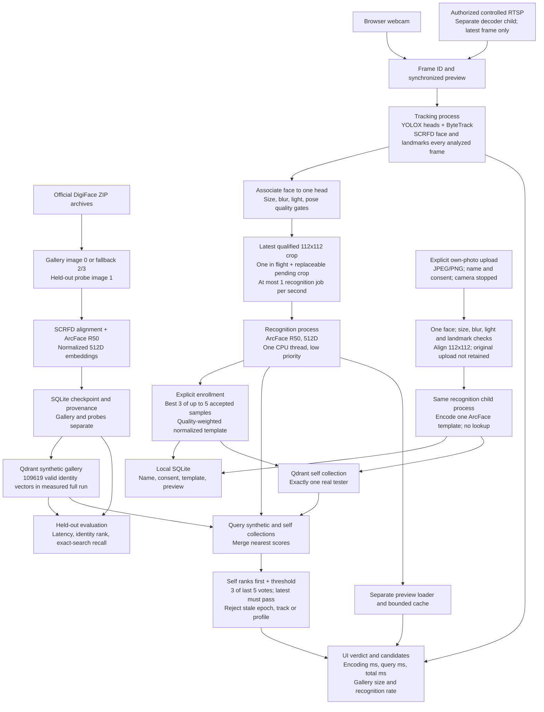

# Local Research Architecture

This is a local CPU research demo: one explicitly consenting tester plus an
immutable gallery of fictional DigiFace identities. The synthetic-only benchmark
can also run independently. It is not an unrestricted real-person gallery, a
production surveillance service or a commercial model licence.

## Tracking and Face Collection

YOLOX-Tiny CrowdHuman produces head detections. ByteTrack maintains local head
IDs, including when a visible head turns away. SCRFD checks every analyzed frame;
a face must be associated unambiguously with the active head. Multiple visible
heads/faces pause this single-tester recognition workflow. The association gate
is geometric, not an identity inference from a turned-away head.

The UI sends the next frame only when the previous tracking request finishes.
The returned frame ID must match the captured pixels before overlays are drawn.
This bounds latency; it does not promise analysis of every native camera frame.
RTSP decoding runs in another child with a one-frame queue and no recording.

Size, sharpness, brightness and landmark geometry reject unsuitable crops.
The background worker encodes eligible aligned crops at most once per second.
Up to five high-quality samples from the same head are retained for 30 seconds;
explicit webcam registration uses the best three. Head continuity allows a gap
shorter than two seconds; longer gaps, track changes and ambiguity reset capture.
A good crop already in flight can enter the sample pool during a later quality
dip only if the same head and capture generation are still current. It cannot
publish an identity verdict while the current face is unusable. Capture samples
and live recognition therefore have separate invalidation generations.

Alternatively, the tester explicitly uploads their own single photo with name and
consent while live capture is stopped. One face and the same quality gates are
required. The recognition child encodes one normalized ArcFace template; no
webcam sample requirement is silently bypassed. Both routes save only the aligned
preview and template, enforce the one-self-profile cap, and remove the local
profile if Qdrant registration fails. Any partial remote write is rejected by
tester ID until a valid enrollment exists. The original photo is not retained.

## Recognition Isolation and Search

Tracking and ArcFace/search use different OS processes. There is one global
in-flight recognition task and one replaceable pending crop per session. A slow
search cannot build an unbounded video queue. Worker failure is reported without
falling back to foreground recognition. ZIP thumbnail decoding stays in the
recognition process's helper thread, not the tracking HTTP lane.

Self-search queries both collections, merges scores and accepts the self profile
only if it ranks first and exceeds the adjustable threshold. Three of five recent
votes are required; the newest vote must pass. The vote window is eight seconds;
source results older than 2.5 seconds are rejected. Losing the face, changing
track/settings/profile, or stopping invalidates pending results. Recognition is
unknown while the face is unavailable; head continuity is not proof of identity.

The UI's count is **gallery size**, not the number of distance operations in an
HNSW query. Search timings exclude ArcFace; encoding and total background timings
are shown separately. A suggested threshold uses a deterministic 80/20 split of
synthetic negatives. It does not establish a real-person false-match rate or a
zero-false-positive threshold.

## Offline Enrollment and Measurement

All eight source archives stay compressed. The full dataset has 1,219,995 images
and 109,999 fictional identity folders. This build enrolls one reference per
identity, not 1.2 million vectors. Failed alignment/detection leaves 109,619 valid
gallery references in the measured full run. Held-out probe image 1 never enters
the gallery. SQLite records model hashes, archive hashes, paths and rejections.

The full result used 300 held-out queries and HNSW `ef=256`. Median search was
2.952 ms and p95 3.538 ms. Correct identity top-1 was 239/300 (79.7%); top-5 was
255/300 (85.0%). Exact-index recall@10 was 96.8%: this measures approximate-index
agreement, not face recognition accuracy. Fresh image-to-result p50 was 167.6 ms
and p95 620.5 ms over 25 probes, excluding model startup. These Mac synthetic
results are not server, GPU, webcam or real-person deployment guarantees.

## Storage and Boundaries

- `.runtime/models`: separately supplied research weights with verified SHA256.
- `.runtime/datasets/DigiFace1M`: official archive downloads and manifest.
- `.runtime/data/digiface_research`: checkpoints and benchmark reports.
- `.runtime/data/qdrant`: native Qdrant storage; no Kafka needed for this local lab.
- `.runtime/data/self_tester`: one consented profile, not committed or distributed.
- `CAMEX_LAB_HOME` relocates large files to an external drive; environment overrides
  are in `settings.py`. Services bind to loopback. RTSP URLs stay in memory.

The model bundle, data, generated registrations and personal threshold reports
are excluded from Git. Commercial model provenance and rights must be resolved
separately. No law-enforcement or unattended public-camera deployment is supplied.
